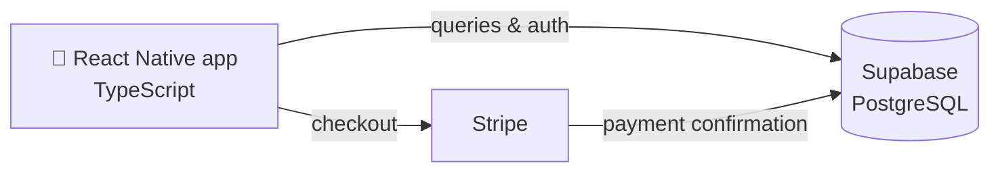
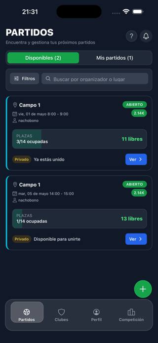
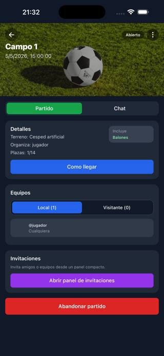
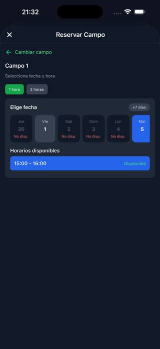
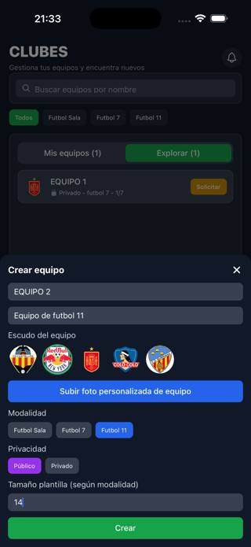
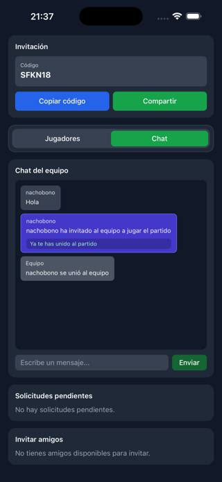
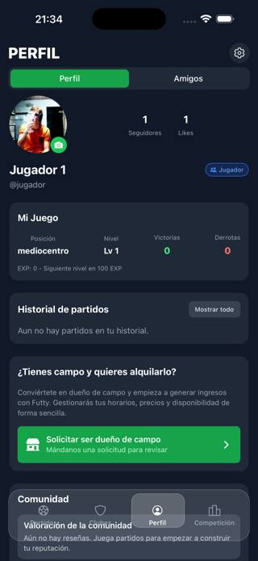

# ⚽ Futty

**Futty connects people who want to play football near them.** Find players in your area, build a team, book a pitch and play — all from your phone.

Built for Castellón (Spain) and ready for launch.

📱 **See it in action:** [Futty on TikTok](https://www.tiktok.com/@futtyapp)

> The source code is private. Code review access is available on request for hiring processes — just reach out.

---

## Features

- **Matches** — browse open matches with free spots near you and join in one tap, or create your own: public or private (invite link), on indoor, artificial or natural grass
- **Pitch booking** — pick a pitch, a date and an available time slot, and get directions to it
- **Clubs & teams** — create a team with its crest, format (futsal, 7-a-side, 11-a-side) and squad size; invite players with a code
- **Team chat** — every team and match has its own chat
- **Player profiles** — position, level, stats, match history, friends and followers
- **Competitive ranking** — monthly leaderboard based on wins, win rate and consistency
- **For pitch owners** — owners can list their pitch and manage schedules, prices and availability
- **In-app payments** — secure payments with Stripe

## Tech stack

| Layer | Technology |
| --- | --- |
| Mobile app | React Native + TypeScript |
| Backend & database | Supabase (PostgreSQL) |
| Payments | Stripe |
| Development | AI-assisted workflow (Claude Code) |

## Architecture

## Screenshots

| Matches | Pitch details | Book a pitch |
| :---: | :---: | :---: |
|  |  |  |
| **Create a team** | **Team chat** | **Player profile** |
|  |  |  |

More in action on [TikTok](https://www.tiktok.com/@futtyapp).

## About me

I'm **Nacho Bono**, a Frontend Software Engineer (React & React Native) at Minsait (Indra). Futty is a side project I designed and built end to end.

- 💼 [LinkedIn](https://www.linkedin.com/in/nachobono)
- 🐙 [GitHub](https://github.com/bonhoff)

---

© Nacho Bono. All rights reserved.
