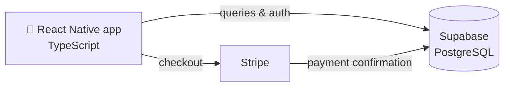

# ⚽ Futty

**Futty connects people who want to play football near them.** Find players in your area, build a team, book a pitch and play — all from your phone.

Built for Castellón (Spain) and ready for launch.

📱 **See it in action:** [Futty on TikTok](https://www.tiktok.com/@futtyapp)

> The source code is private. Code review access is available on request for hiring processes — just reach out.

---

## Features

- **Find players nearby** — join people around you who are looking for a game
- **Teams** — create a team or join an existing one
- **Pitch booking** — rent a football pitch directly from the app
- **Matches** — organize and play matches with your team
- **In-app payments** — secure payments with Stripe

## Tech stack

| Layer | Technology |
| --- | --- |
| Mobile app | React Native + TypeScript |
| Backend & database | Supabase (PostgreSQL) |
| Payments | Stripe |
| Development | AI-assisted workflow (Claude Code) |

## Architecture

## Screenshots

<!-- Add 3–4 screenshots here, e.g.:

  
  
  

-->

_Screenshots coming soon. Meanwhile, check the [demo videos on TikTok](https://www.tiktok.com/@futtyapp)._

## About me

I'm **Nacho Bono**, a Frontend Software Engineer (React & React Native) at Minsait (Indra). Futty is a side project I designed and built end to end.

- 💼 [LinkedIn](https://www.linkedin.com/in/nachobono)
- 🐙 [GitHub](https://github.com/bonhoff)

---

© Nacho Bono. All rights reserved.
